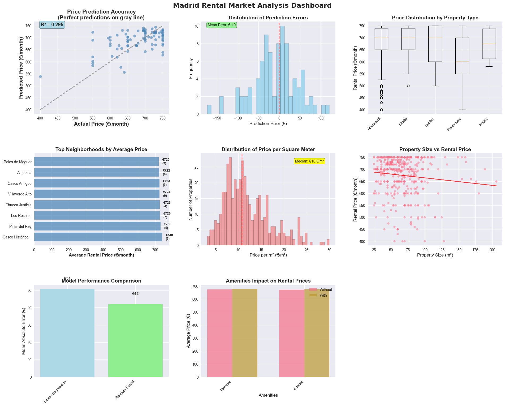

# Madrid Rental Property Analysis

Analysis of Madrid rental listings from the Idealista API: data cleaning, SQL queries on a SQLite database, and a machine learning model that predicts monthly rent.

## Data

- **Source:** Idealista API, rental listings for Madrid and the surrounding area
- **File:** `data/idealista_api_rent_madrid.csv`
- **Size:** 450 listings, 40 columns (price, size, rooms, bathrooms, property type, location, amenities, description and more)
- **Price range:** €340 to €750 per month

The data is not a full picture of the Madrid rental market. Rents only go up to €750 per month, and some listings come from towns outside the city of Madrid.

## Methods

1. **Cleaning and preprocessing**
   - Drop rows with missing price or size and remove duplicates
   - Filter price and size outliers using quantiles and fixed price bounds
   - Derive `price_per_sqm`, a simplified `property_category` and binary amenity flags (elevator, exterior, parking)
2. **SQLite and SQL**
   - Load the cleaned data into `madrid_rentals.db` (table `properties`) and add indexes on location, property type, size and price
   - Queries: neighborhoods with the highest price per m², summary by property type, rent with and without amenities, and price per m² by size segment
3. **Machine learning**
   - Features: size, rooms, bathrooms, amenity flags, floor, neighborhood, district and property type
   - Preprocessing pipeline with one-hot encoding and standard scaling
   - Linear Regression and Random Forest on an 80/20 train/test split
   - GridSearchCV over Random Forest hyperparameters and 5-fold cross-validation
4. **Statistical testing**
   - Welch's t-tests on rent with and without an elevator, and for exterior vs. interior properties

## Results

All numbers come from the saved outputs in the notebook.

| Metric | Value |
|--------|-------|
| Listings after cleaning | 431 of 450 |
| Linear Regression test MAE / R² | €51 / 0.091 |
| Random Forest test MAE / R² | €42 / 0.295 |
| Tuned Random Forest test MAE / R² | €44 / 0.273 |
| Random Forest 5-fold CV MAE | €51 ± €6 |
| Test predictions within €50 / €100 of actual rent | 67.8% / 92.0% |

Other findings:

- Small properties (under 50 m²) average €18.6 per m², compared with €10.7 per m² for 50 to 80 m² and €4.2 per m² above 120 m².
- Studios have the highest average price per m² of the property types (€19.4).
- Neither an elevator (p = 0.62) nor an exterior position (p = 0.73) is linked to a statistically significant difference in rent. No cleaned listing had a parking space.
- Size has a weak negative correlation with rent in this sample (-0.106), which reflects the narrow price range of the data.
- Both models overfit (training MAE well below test MAE), and a test R² of 0.295 means most of the variation in rent is not explained by the available features.

## Figures

Dashboard from the notebook's evaluation cell: predicted vs actual rent for the Random Forest model, prediction errors, rent by property type, the most expensive neighborhoods (listing counts in brackets), price per m², size vs rent, test MAE of both models and rent with and without amenities.



## How to Run

Requires Python 3.9 or newer.

```bash
pip install -r requirements.txt
jupyter notebook madrid_rental_analysis.ipynb
```

Run the cells in order (Kernel > Restart & Run All). The notebook reads `data/idealista_api_rent_madrid.csv` and writes `madrid_rentals.db`, both relative to the repository root.

## Project Structure

```
.
├── data/
│   └── idealista_api_rent_madrid.csv   # Raw listings from the Idealista API
├── docs/
│   └── images/                         # Figures used in this README
├── madrid_rental_analysis.ipynb        # Cleaning, SQL, modeling and charts
├── madrid_rentals.db                   # SQLite database with the cleaned data
├── requirements.txt                    # Python dependencies
├── LICENSE
└── README.md
```

## License

MIT, see [LICENSE](LICENSE).
